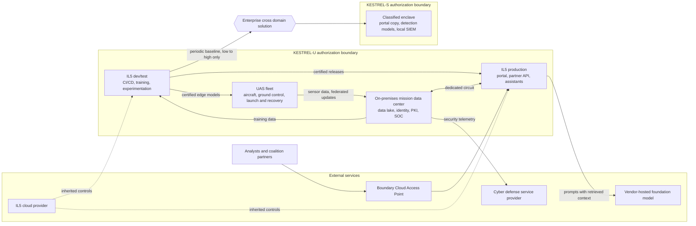

# KESTREL System Description

> **Notional system.** KESTREL is fictional. Its names, scale, and suppliers are invented, and nothing here describes a real program or an operational capability.

This document describes what KESTREL is, where its authorization boundaries fall, and how data moves through it. It is the first step a PMO ISSE takes before applying the SABER, since categorization, tailoring, and the SADD all depend on a stable picture of the system. It stops short of categorization. Information types, impact values, and the control baseline belong in the Categorization and Control Selection Document (CCSD), which is the next document in this repository.

Every component below carries the SABER's own Deployment Type and Affected Components values. Using the same vocabulary here means the SADD can later filter the SABER's outcomes against KESTREL's actual footprint without translating terms.

## Mission and Purpose

KESTREL gives analysts timely, model-assisted intelligence from airborne sensor data. A fleet of unmanned aircraft collects imagery and signals over an area of interest, and onboard detection models flag objects of interest while the aircraft is still airborne. On the ground, KESTREL stores the full sensor record, retrains its models on new data and analyst corrections, and serves the results to analysts, operators, and coalition partners.

The program's value depends on two things working together. First, the models must improve continuously, because adversaries change their equipment and tactics faster than a fixed model can follow. Second, the results must reach users at two classification levels, namely the unclassified environment where most analysis happens and a SECRET enclave where analysts combine KESTREL's output with classified holdings.

## Program and Authorization Boundaries

KESTREL is one program that fields two systems. The KESTREL program office owns both, and one PMO ISSE tailors the SABER once for the program. Both systems therefore share one SADD, one Security Implementation Plan, and one set of governing plans, such as the AMP, CMP, IRP, CP, and AISP. However, each system has its own authorization boundary, its own CCSD, its own System Security Plan (SSP), and its own authorization package. Both are authorized under DoD RMF in accordance with DoDI 8510.01, and the same Authorizing Official (AO) authorizes each one separately.

| System | Boundary | Classification | Hosting |
| :--- | :--- | :--- | :--- |
| **KESTREL-U** | The IL5 development and test environment, the IL5 production environment, the on-premises mission data center, and the UAS fleet | Controlled unclassified information and unclassified national security information | Commercial cloud at IL5, program-owned data center, and fielded aircraft with their ground equipment |
| **KESTREL-S** | The classified enclave | SECRET | A program-owned, standalone enclave inside an accredited secure facility |

The two systems are kept separate because they differ in classification, connectivity, and the people cleared to administer them. Combining them would force every KESTREL-U administrator and component under SECRET controls, or else leave the enclave under controls written for an unclassified system. Instead, a cross domain solution joins them, and an interconnection agreement governs that connection under System Interconnection Agreements (ISA/MOU/MOA) (`GV-5.6`).

The diagram below shows both boundaries, the services KESTREL inherits from or depends on outside them, and the one path between the two systems.

KESTREL-U inherits physical, environmental, and infrastructure controls from its cloud provider's DoD Provisional Authorization at IL5. It also inherits boundary protection from the Boundary Cloud Access Point that fronts the IL5 environment, which Authorized Cloud Access Point Integration (`NE-2.13`) covers. Finally, it receives cyber defense services from a cyber defense service provider, aligned under Cyber Defense Service Provider Alignment (`RS-1.7`). KESTREL-S inherits nothing from a cloud provider, since it runs entirely on program-owned hardware.

## KESTREL-U Components

### IL5 Development and Test

This segment builds KESTREL's software and trains its models. No user outside the program team can reach it, and it holds the only copies of the training pipeline and the experimentation workspaces.

| Component | What it does | Deployment Type | Affected Components |
| :--- | :--- | :--- | :--- |
| Source repository and CI/CD pipeline | Builds, tests, signs, and releases the portal, partner API, and serving code | Cloud | CI/CD Pipeline, Infrastructure-as-Code (IaC), First-Party/Custom Application Code |
| Artifact and model registry | Stores signed container images, packages, and trained model versions with their lineage | Cloud | Artifact/Model Registry |
| Model training cluster | Runs training and fine-tuning jobs on GPU nodes under a managed Kubernetes service | Cloud | Container, Container Orchestration Control Plane |
| Federated learning aggregator | Combines model updates contributed by the aircraft into a candidate model | Cloud | Container, Self-Hosted Model |
| Experimentation workspaces | Hosts notebooks where data scientists explore data and prototype models | Cloud | Virtual Machine/Server |
| Development secrets vault | Holds pipeline and workload secrets for this segment | Cloud | Secrets Vault |

### IL5 Production

This segment serves every user-facing application. It is the only part of KESTREL-U that users outside the program team can reach, and they reach it only through the Boundary Cloud Access Point.

| Component | What it does | Deployment Type | Affected Components |
| :--- | :--- | :--- | :--- |
| Analyst portal | Web application where analysts search detections, review imagery, and submit corrections | Cloud | First-Party/Custom Application Code, Client-Side/Browser-Executed Code |
| Partner API | Releases approved detections and reports to coalition partner systems | Cloud | API/Interface Contract, First-Party/Custom Application Code |
| Edge services | Terminates user traffic, inspects it, and routes it to the portal and API | Cloud | Load Balancer/Reverse Proxy/API Gateway, Web Application Firewall, DDoS Protection |
| Detection model serving | Serves the cloud versions of KESTREL's detection models to the portal | Cloud | Self-Hosted Model, Fine-Tuned Model, AI Interface/Inference Endpoint |
| LLM analyst assistant | Answers analyst questions using retrieval over mission reports and a vendor-hosted foundation model | Cloud | Third-Party API Model, Foundation Model, Retrieval-Augmented Generation (RAG), Prompt/Instruction Layer |
| Mission report index | Stores embeddings of mission reports for the assistant's retrieval | Cloud | Vector Store/Embedding Index, Embedding Model |
| Mission-planning agent | Drafts flight plans and collection requests that an operator must approve before they take effect | Cloud | AI Agent, AI Agent Identity |
| Feedback endpoints | Capture analyst corrections and route them to the data lake for retraining | Cloud | API/Interface Contract, Message Queue/Event Stream |

The LLM analyst assistant is the one component that sends program data outside KESTREL-U's boundary. Each prompt carries excerpts of mission reports to a foundation model the vendor hosts in its own IL5-authorized environment. Third-Party/Foundation Model API Dependency Governance (`AI-8.3`) governs what may be sent and what the vendor may retain.

### On-Premises Mission Data Center

This segment holds the authoritative mission data and the services every other segment depends on. A dedicated circuit links it to the IL5 environment, which makes their joint operation the Hybrid case in the SABER's Deployment Type values.

| Component | What it does | Deployment Type | Affected Components |
| :--- | :--- | :--- | :--- |
| Mission data lake | Holds the full sensor record, labeled training sets, mission reports, and analyst corrections | On-Premises | Object/File Storage, Analytics/Warehouse Service |
| Identity provider and directory | Authenticates users and workloads across KESTREL-U and issues their group memberships | On-Premises, Hybrid | Directory/Platform Core Infrastructure, Human Authentication |
| Privileged access platform | Brokers just-in-time elevation, vaults shared credentials, and records privileged sessions | On-Premises, Hybrid | Privileged Access Management |
| PKI and HSMs | Issues device, workload, and code-signing certificates and protects the signing keys | On-Premises | PKI/Certificate Authority, Cryptographic Hardware/HSM |
| Security operations center | Aggregates logs from all four segments, correlates them, and runs response playbooks | On-Premises, Hybrid | Security Information and Event Management (SIEM) Platform |
| Backup and archive | Keeps recovery copies of the data lake, registries, and configuration under retention lock | On-Premises | Backup/Archive Repository |
| Cloud interconnect | Carries all traffic between the data center and the IL5 environment over a dedicated circuit | Hybrid | Private Connectivity/Dedicated Circuit |

### UAS Fleet

This segment flies the missions. It is the Cyber-Physical System (OT/ICS) part of KESTREL, and a fault here can cost an aircraft rather than a record.

| Component | What it does | Deployment Type | Affected Components |
| :--- | :--- | :--- | :--- |
| Aircraft | Twelve unmanned aircraft, each carrying a sensor payload and an onboard detection model | Cyber-Physical System (OT/ICS) | Edge/Embedded AI Device, Industrial Controller/SCADA |
| Ground control stations | Four stations from which operators fly the aircraft and monitor the payload | Cyber-Physical System (OT/ICS) | Industrial Controller/SCADA, OT/Legacy Device Identity |
| Launch and recovery equipment | Launches and recovers the aircraft at each operating site | Cyber-Physical System (OT/ICS) | Industrial Controller/SCADA |
| Command and payload datalinks | Carry encrypted command uplink, telemetry, and payload downlink between aircraft and station | Cyber-Physical System (OT/ICS) | Wireless/RF Infrastructure |
| Ground segment network | Connects the stations and launch equipment, zoned apart from the data center's IT network | Cyber-Physical System (OT/ICS) | OT/ICS Zone-Conduit Segmentation (IEC 62443), OT/ICS Passive Network Monitoring |
| Payload processing workstation | Converts raw payload recordings into the lake's format, and runs an operating system its vendor no longer supports | Cyber-Physical System (OT/ICS) | Legacy IT (Unpatchable, Non-Industrial) |

The payload processing workstation stays in service until its replacement fields, because the payload vendor certifies its conversion software only on that operating system. It runs under compensating controls in the meantime, which Secure OT/Legacy Device Baselines (`DI-3.5`) covers.

## KESTREL-S Components

KESTREL-S gives cleared analysts KESTREL's tools inside a SECRET enclave. It has no network connection to anything outside its boundary. The only data that enters it arrives through the cross domain solution, and no data leaves it by any electronic path.

| Component | What it does | Deployment Type | Affected Components |
| :--- | :--- | :--- | :--- |
| Enclave application servers | Run the enclave's copy of the analyst portal | On-Premises, Air-Gapped/Isolated | Virtual Machine/Server, First-Party/Custom Application Code |
| Enclave model serving | Serves the detection models delivered in each baseline | On-Premises, Air-Gapped/Isolated | Self-Hosted Model, AI Interface/Inference Endpoint |
| Enclave data store | Holds delivered reference data and the analysts' classified work products | On-Premises, Air-Gapped/Isolated | Database Service, Object/File Storage |
| Enclave identity | A local directory that authenticates analysts with NSS PKI tokens | On-Premises, Air-Gapped/Isolated | Directory/Platform Core Infrastructure, Human Authentication |
| Analyst workstations | Managed workstations inside the secure facility | On-Premises, Air-Gapped/Isolated | Managed Device (Laptop/Desktop) |
| Enclave SIEM | Collects and correlates the enclave's logs locally | On-Premises, Air-Gapped/Isolated | Security Information and Event Management (SIEM) Platform |

Two KESTREL-U capabilities do not carry over. First, the enclave has no LLM analyst assistant, since its foundation model is vendor-hosted and the enclave cannot reach it. Second, enclave logs never reach the KESTREL-U security operations center, because nothing leaves the enclave electronically. Cleared staff review them in place on the enclave SIEM.

## Data Flows

The table lists every flow that crosses a segment or boundary. Flows inside a single component, such as a training job reading from its own scratch storage, are left out.

| # | From | To | Data | Crosses | Protection |
| :--- | :--- | :--- | :--- | :--- | :--- |
| F1 | Ground control station | Aircraft | Flight commands | RF link | Authenticated, encrypted command uplink |
| F2 | Aircraft | Ground control station | Telemetry and live payload video | RF link | Encrypted downlink |
| F3 | Ground control station | Mission data lake | Full sensor recordings and federated model updates after each mission | OT zone to IT network | Conduit through the ground segment firewall, transfer integrity check |
| F4 | Mission data lake | IL5 dev/test | Labeled training sets and analyst corrections | On-premises to cloud | Dedicated circuit, TLS, dataset provenance record |
| F5 | IL5 dev/test | IL5 production | Certified application and model releases, continuously | Segment | Signed artifacts released only through Certification to Field |
| F6 | IL5 dev/test | Ground control stations | Certified edge models, as periodic baselines | Cloud to OT | Signed packages loaded during maintenance windows, signature verified on the aircraft |
| F7 | Analysts and partners | IL5 production | Portal sessions and API calls | Internet to boundary | Boundary Cloud Access Point, TLS, DoD PKI or External Certificate Authority credentials |
| F8 | IL5 production | Mission data lake | Queries, mission reports, and analyst corrections | Cloud to on-premises | Dedicated circuit, TLS, workload identity |
| F9 | LLM analyst assistant | Vendor-hosted foundation model | Prompts with retrieved report excerpts, and responses | KESTREL-U boundary | Private connectivity to the vendor's IL5 environment, no-retention terms |
| F10 | All KESTREL-U segments | Security operations center | Logs and security telemetry | Segment | Encrypted log forwarding over the dedicated circuit |
| F11 | Security operations center | Cyber defense service provider | Security telemetry and incident reports | KESTREL-U boundary | Feed and reporting terms in the service agreement |
| F12 | IL5 dev/test | KESTREL-S | Periodic baselines of applications, models, and reference data | KESTREL-U to KESTREL-S | Enterprise cross domain solution, low to high only |

Flow F12 is the only connection between the two systems, and it runs in one direction. Each baseline is assembled in dev/test and approved for the enclave through Certification to Field. It then goes to an enterprise cross domain solution, drawn from the NCDSMO Baseline List and operated by a DoD cross domain service provider. The program does not own the cross domain solution, so it sits outside both boundaries, and Cross Domain Solution (CDS) Transfer Procedures (`NE-2.10`) govern how KESTREL uses it. If the cross domain solution is unavailable for an extended period, a baseline may move by a governed manual media transfer instead.

## Users and Roles

### People

| Role | System | Access |
| :--- | :--- | :--- |
| Analysts | KESTREL-U | Analyst portal and LLM analyst assistant, about 300 users |
| Enclave analysts | KESTREL-S | Enclave portal from workstations inside the secure facility, about 60 users holding SECRET clearances |
| UAS operators | KESTREL-U | Ground control stations and the operator functions of the portal, and approval of the mission-planning agent's drafts |
| Coalition partners | KESTREL-U | Partner API only, from five partner nations under program sponsorship |
| Data scientists and ML engineers | KESTREL-U | Dev/test only, including experimentation workspaces and the training cluster |
| Platform administrators | KESTREL-U | Privileged access to the cloud environments and the data center, through the privileged access platform |
| Enclave administrators | KESTREL-S | Privileged access to the enclave, held by cleared staff who hold no KESTREL-U privileged role |
| SOC analysts | KESTREL-U | Security operations center tools and read access to security telemetry |
| OT maintainers and vendor support | KESTREL-U | Ground control stations and launch equipment during scheduled maintenance windows, with vendor sessions brokered and recorded |

Coalition partners authenticate with External Certificate Authority or federated partner PKI credentials, which External PKI Trust and Sponsorship (`ID-1.2`) governs. Vendor support access follows Access Process for Third-Party Support (`ID-4.7`). No role in KESTREL allows anonymous or general-public access.

### Non-Person Entities

- **Pipeline identities** let CI/CD jobs build, sign, and publish artifacts without stored human credentials.
- **Workload identities** let production services read the data lake and the mission report index.
- **The mission-planning agent** has its own identity, scoped to reading mission data and drafting plans. It cannot task an aircraft without an operator's approval.
- **Aircraft and ground station device identities** authenticate the datalinks and the loading of model packages.

## Interconnections and External Dependencies

| Party | Connects to | Basis |
| :--- | :--- | :--- |
| IL5 cloud provider | KESTREL-U dev/test and production | DoD Provisional Authorization at IL5, with a customer responsibility matrix |
| Boundary Cloud Access Point | KESTREL-U production | DoD cloud access boundary for all inbound user traffic |
| Cyber defense service provider | KESTREL-U security operations center | Service agreement dividing detection and response responsibilities |
| Enterprise cross domain service provider | KESTREL-U dev/test and KESTREL-S | Interconnection agreements covering each side of the transfer |
| Foundation model vendor | KESTREL-U LLM analyst assistant | IL5 authorization of the vendor's service and data governance terms |
| Coalition partner systems | KESTREL-U partner API | Memoranda of agreement with each partner nation |
| DoD PKI and External Certificate Authorities | KESTREL-U identity provider | Trust anchors for user and partner credentials |

## Assumptions and Exclusions

- **Enterprise email and collaboration** come from the parent organization's enterprise services and stay outside both boundaries. The SABER does not cover them either.
- **Airworthiness** is certified through a separate process. KESTREL's authorization covers the cybersecurity of the aircraft and ground systems, not their flight safety.
- **Personnel and physical security,** including the secure facility that houses KESTREL-S, belong to the program's PSO. KESTREL describes how its systems rely on them, not how they are run.
- **High to low transfer** is out of scope. Nothing leaves KESTREL-S electronically, and releasing classified work products to lower levels follows the parent organization's own release process.
- **Scale figures** such as twelve aircraft and about 300 analysts are illustrative. They exist to make sizing decisions concrete, not to describe a real fleet.
