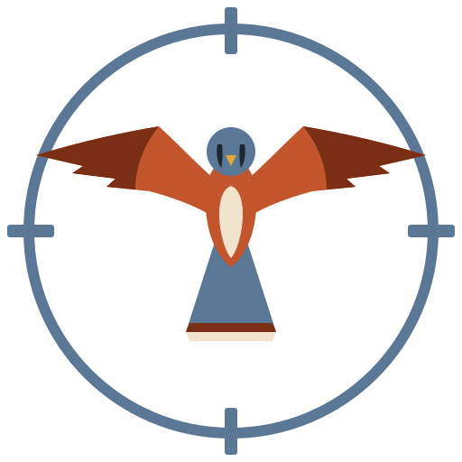
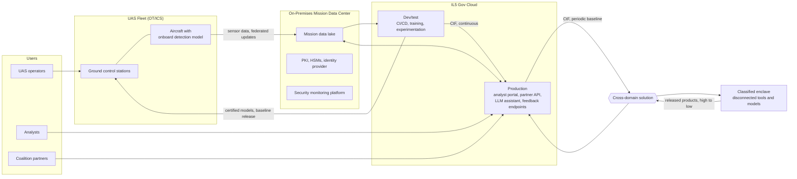

# KESTREL: The SABER Applied

KESTREL is a **notional system** built to show the SABER (Security Architecture and Baseline Engineering Reference) applied in practice. It follows a PMO ISSE through the whole path the SABER is designed to support: categorizing a system, tailoring the framework to it, producing a Security Architecture and Design Document (SADD), and carrying that design into an issue-tracker Implementation Plan.

> **KESTREL is fictional.** It is not a real program, it holds no real data, and any resemblance to an actual system is coincidental. Its architecture is realistic so that every SABER decision made against it is a decision a real program would face, but nothing here describes an operational capability.

## Where things live

KESTREL's real tools would be self-hosted inside its authorization boundary. Here, GitHub stands in for them:

| Open | Stands in for | What you'll find |
|---|---|---|
| [`docs/`](docs/) | Configuration-controlled documents | The system description, CCSD, SADD, and Security Implementation Plan |
| [Project board](https://github.com/users/jessestarkey/projects/3) | Jira board | The Identity focus area's work, with each item's phase, team, dates, and activity metadata |
| [Issues](https://github.com/jessestarkey/Kestrel/issues) | Jira issues | The same work as initiative, epics, stories, and sub-tasks, with blocked-by links between stories |
| [Wiki](https://github.com/jessestarkey/Kestrel/wiki) | Confluence | The governing plans, starting with the Account Management Plan, and the runbooks that carry them out |

The pinned issue [About this demonstration](https://github.com/jessestarkey/Kestrel/issues/179) explains the mapping in more detail. Only the Identity focus area is loaded on the board and in the issues so far.

## Why a notional system

The SABER is a framework: it defines outcomes, activities, control mappings, and metadata, but it deliberately stops short of any one program's design. A framework that only exists in the abstract is hard to evaluate. KESTREL gives it something concrete to act on, chosen so that most of the SABER applies and the parts that get tailored out are excluded for a stated reason, not because the example was too small to need them.

## The system

KESTREL is a hybrid ISR (intelligence, surveillance, and reconnaissance) analytics platform. A fleet of unmanned aircraft collects sensor data and runs onboard detection models. An IL5 cloud and on-premises backend trains and improves those models, manages the mission data, and serves applications to operators, analysts, and coalition partners.

| Segment | What it hosts |
| :--- | :--- |
| **IL5 platform spokes** | The shared CI/CD pipeline, artifact and model registry, package mirror, and DNS, with a dev/test spoke for testing platform changes. |
| **IL5 ML spokes** | Model training and experimentation in dev/test, and every model serving endpoint, including the CSP-hosted foundation model, in prod. |
| **IL5 mission team spokes** | A dev/test and a prod spoke for each mission team. Mission Team 1 handles EO/IR imagery from Payload Vendor A and runs the analyst portal and the LLM analyst assistant. Mission Team 2 handles RF signals from Payload Vendor B and runs the signals workbench, the partner API, and the mission-planning agent. |
| **IL5 DMZ and VDI spokes** | Everything users reach first, namely edge services, the identity-aware access proxy for the performer's CMMC Level 2 laptops, the VDI brokers, and the cross domain gateway, plus the platform team's admin desktops. |
| **On-premises mission data center** | The authoritative mission data lake, PKI and HSMs, the identity provider, and the security monitoring platform the Security Team and the CSSP work from. |
| **Alternate site** | A warm standby of identity and the PKI, a second HSM, and backup copies, in a parent organization facility. |
| **UAS fleet** | Aircraft, ground control stations, and launch and recovery equipment (OT/ICS), each aircraft running an onboard detection model and contributing federated model updates. |

### Users

- **UAS operators** are privileged, mission-critical users working from ground control stations and the operator side of the portal.
- **Analysts** use the IL5 portal and the LLM assistant, and submit corrections that feed retraining.
- **Coalition partners** reach the partner API with federated or External Certificate Authority PKI credentials under program sponsorship.

There is no anonymous or general-public access. IL5 holds controlled unclassified and unclassified national security information, so "external" here means authenticated, sponsored users from outside the program team, entering through the DoD cloud access boundary rather than directly from the internet.

## How KESTREL exercises the SABER

| Pillar | Focus Area | Why KESTREL needs it |
| :--- | :--- | :--- |
| Protect | Identity | DoD users, coalition partners with external PKI, workload and pipeline identities, an agentic mission-planning assistant, and privileged operators with OT maintenance-window access. |
| Protect | Device and Infrastructure | Cloud workloads, on-premises servers, HSMs, ground control stations, and the aircraft themselves. |
| Protect | Network and Environment | Hub-and-spoke segmentation between teams and between dev/test and prod, an externally exposed production boundary, the hybrid circuit to the data center, two-way cross domain transfer, and OT network isolation. |
| Protect | Application | The analyst portal and partner API, shipped continuously through Certification to Field to IL5 production and as periodic baselines to the IL6 enclave. |
| Protect | Artificial Intelligence | The full model lifecycle: training, Continuous Training from analyst feedback and federated fleet updates, cloud and edge serving, RAG, a cloud-hosted foundation model, an agentic assistant, and safety-critical AI on aircraft. |
| Protect | Data | Mission data classification, provenance, and lineage, key management, and incidental PII captured in imagery. |
| Operate | Detection, Response, Recovery | An externally exposed production environment and a fielded fleet give the Security Team and its CSSP real telemetry, real incidents, and real recovery requirements across four deployment types. |
| Manage | Governance, Risk, Compliance | One authorization package at IL5, risk acceptance at the certification gate, and continuous monitoring spanning cloud, on-premises, hybrid, and OT environments. |

Two parts of the SABER are especially well exercised:

- **Both release cadences.** IL5 production receives continuous per-build releases, while the aircraft and the IL6 enclave receive periodic baselines. Both pass through the same Certification to Field gate, which is the case that gate was designed to cover.
- **Continuous Training as a real loop.** Analyst corrections and federated fleet updates flow back into retraining, so the feedback authentication, skew detection, and drift monitoring outcomes all have real inputs to act on.

### Tailored out

Enterprise email and collaboration remain outside the SABER's scope and are not modeled here. KESTREL also stops at IL5. It exchanges data with an IL6 enclave through a two-way cross domain solution, but that enclave is a separate system and its design is not modeled. Any other outcome KESTREL does not need is tailored out in the SADD with its reason recorded, rather than silently omitted.

## Planned contents

The repository will grow along the same path a PMO ISSE follows. The authorization and design documents live in `docs/`, numbered in the order they are written:

1. **System description** ([docs/01-system-description.md](docs/01-system-description.md)): authorization boundary, components, data flows, users, and interconnections.
2. **Categorization and control selection** ([docs/02-ccsd.md](docs/02-ccsd.md)): information types, impact values, overlays, and tailoring, in the CCSD.
3. **SADD** ([docs/03-sadd/](docs/03-sadd/index.md)): which SABER outcomes apply, which drop out and why, and the design intent for each, one file per focus area.
4. **Security Implementation Plan** ([docs/04-sip/](docs/04-sip/index.md)): the products chosen for each SADD outcome, the team that delivers it, and a four-phase rollout, with each record ready to load into Jira as a story and its sub-tasks.
5. **Plan-type deliverables** (the [wiki](https://github.com/jessestarkey/Kestrel/wiki), standing in for KESTREL's Confluence, with page sources in `tools/github/wiki/`): KESTREL-specific instances of the SABER's governing plans, starting with the Account Management Plan, and the runbooks that carry them out.

The system description, CCSD, SADD, and Security Implementation Plan are written. The rest follow in order.

Three more folders will hold the material that shows the design built, not just documented:

- **`threat-models/`** holds threat models for KESTREL's components and data flows, along with any modeling tool files.
- **`iac/`** holds infrastructure as code, such as Terraform, Kubernetes manifests, and policy as code, that implements SABER outcomes.
- **`src/`** holds code examples, such as pipeline security gates and model serving controls.

Each folder appears when its first file does. A fourth folder, **`tools/`**, holds the scripts that generate parts of the documents, such as the [SADD build](tools/sadd/README.md).

## Relationship to the SABER

KESTREL is built against **SABER v1.3**, maintained in the separate [saber-framework](https://github.com/jessestarkey/saber-framework) repository. When this repository cites a SABER outcome or activity, it uses the SABER's own ID and name (for example, `AI-6.5: Deployment Risk Threshold Evaluation`). If the SABER changes, this repository records which version it was last aligned to rather than silently drifting.
