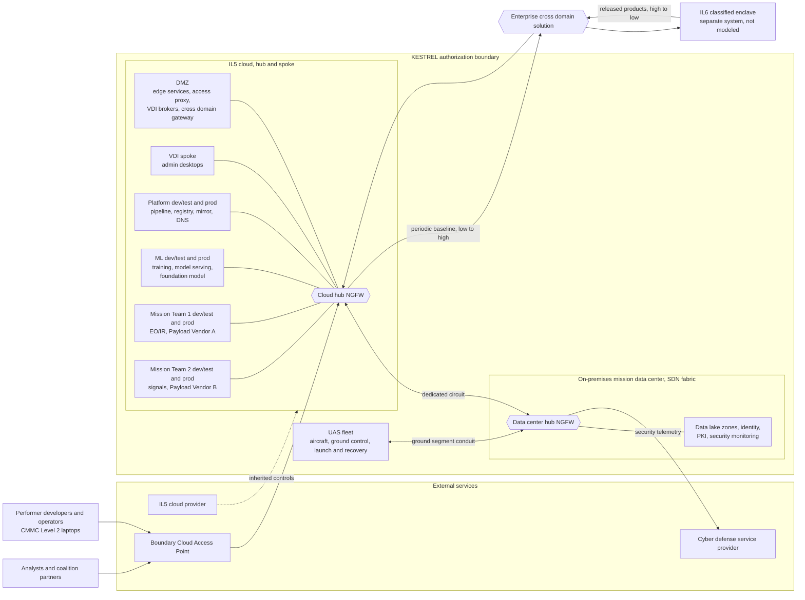

# KESTREL System Description

> **Notional system.** KESTREL is fictional. Its names, scale, and suppliers are invented, and nothing here describes a real program or an operational capability.

This document describes what KESTREL is, where its authorization boundary falls, and how data moves through it. It is the first step a PMO ISSE takes before applying the SABER, since categorization, tailoring, and the SADD all depend on a stable picture of the system. It stops short of categorization. Information types, impact values, and the control baseline belong in the Categorization and Control Selection Document (CCSD), which is the next document in this repository.

Every component below carries the SABER's own Deployment Type and Affected Components values. Using the same vocabulary here means the SADD can later filter the SABER's outcomes against KESTREL's actual footprint without translating terms.

## Mission and Purpose

KESTREL gives analysts timely, model-assisted intelligence from airborne sensor data. A fleet of unmanned aircraft collects imagery and signals over an area of interest, and onboard detection models flag objects of interest while the aircraft is still airborne. On the ground, KESTREL stores the full sensor record, retrains its models on new data and analyst corrections, and serves the results to analysts, operators, and coalition partners.

The program's value depends on its models improving continuously, because adversaries change their equipment and tactics faster than a fixed model can follow. KESTREL therefore treats retraining as part of normal operations rather than as a periodic upgrade.

## Authorization Boundary

KESTREL is one system inside one authorization boundary, authorized under DoD RMF in accordance with DoDI 8510.01. The program office owns it, and its PMO ISSE produces one CCSD, one System Security Plan (SSP), one SADD, and one authorization package for the Authorizing Official (AO).

| Boundary | Classification | Hosting |
| :--- | :--- | :--- |
| The IL5 cloud's hub and ten spokes, the on-premises mission data center, and the UAS fleet | Controlled unclassified information and unclassified national security information, at IL5 | Commercial cloud at IL5, a program-owned data center, and fielded aircraft with their ground equipment |

KESTREL itself operates at IL5. It also exchanges data with a SECRET enclave at IL6 through a two-way enterprise cross domain solution. That enclave is a separate system with its own boundary and authorization package, and this example covers only KESTREL's side of the connection.

## Teams

The government's program office directs KESTREL, eight performer teams build and run it, and three outside parties check or support it. The network is organized around the teams that own cloud spokes, namely Platform, ML, and the two mission teams.

| Team | Party | Owns |
| :--- | :--- | :--- |
| **Program Office** | Government | Direction and approval. Its program managers, chief engineer, and PMO ISSE own the requirements and the security design, and the PMO ISSE runs Certification to Field. A government product owner for each performer team owns that team's backlog and accepts its work. Intelligence mission leads define mission requirements and are the owners of the mission data. The foreign disclosure officer approves every release to partners, and the privacy officer and supply chain lead complete the office. |
| **Platform Team** | Performer | Cloud and data center infrastructure, namely the cloud and data center hubs and their shared rule base, the SDN fabric, DNS, the circuit, backup, the DMZ, and the VDI spoke. It also owns the shared services every other team builds through, namely the source repository and CI/CD pipeline, the artifact and model registry, the package mirror, and the test tooling every team's tests run on. Tier 0, meaning the identity provider, PKI, and HSMs, is held by a small named subset of its administrators. |
| **IT Operations** | Performer | The service desk and routine operations, namely user tickets, access requests, CAC problems, partner onboarding, scheduled patch windows, backup checks, and runbooks. Its changes go through the pipeline or the privileged access platform, never through direct console access. |
| **Security Team** | Performer | The ISSM, who receives an appointment letter from the government, the ISSOs, and the on-premises security analysts. It owns the authorization package, the POA&M, and continuous monitoring. It also carries out hands-on incident response, tunes detection for OT and KESTREL-specific systems, and works with the CSSP. It holds read and audit access to the systems it watches but none of the administrative roles it checks. |
| **Fleet Operations** | Performer | The aircraft, ground control stations, launch and recovery equipment, and ground segment network. Its UAS operators fly the missions, and its OT maintainers work within scheduled maintenance windows, coordinating vendor support. It loads certified edge models onto the aircraft and operates the payload processing workstation. |
| **Data Team** | Performer | The data lake's ingest pipelines, conversion hosts, labeling, catalog and classification, provenance, and retention. It is the only team that moves data from a mission team's zone into the ML training zone, and it does so only for data that zone's owner has released for training under that payload vendor's terms. |
| **ML Team** | Performer | Every model KESTREL trains or hosts, namely the detection models in the cloud and on the aircraft, the embedding model, and the deployment of the CSP-hosted foundation model. It exposes each model to the mission teams as an endpoint and produces the evidence each model's Certification to Field needs. It reads only the ML training zone. |
| **Mission Team 1** | Performer | Electro-optical and infrared (EO/IR) imagery and full-motion video from Payload Vendor A, along with the analyst portal, the LLM analyst assistant, and the mission report index. |
| **Mission Team 2** | Performer | Radio frequency (RF) signals from Payload Vendor B, along with the signals workbench, the partner API, and the mission-planning agent. |
| **Cyber defense service provider (CSSP)** | External | Around-the-clock monitoring, triage, threat intelligence, and incident handling, delivered remotely under its service agreement. |
| **Penetration testers** | External | Independent testing under rules of engagement, at least annually for the whole system, every six months for the DMZ and other paths reachable from outside, and after any major change such as a new spoke, interconnection, or external API. Fleet systems are tested on spares or a simulator, never on live aircraft. |
| **Security Control Assessor (SCA)** | External | Independent assessment of KESTREL's controls for the AO. |

The two mission teams are split by payload vendor because each vendor delivers its data in its own format, with its own conversion software and its own data rights terms. Keeping each vendor's raw collection, detections, and licensed tools inside its own team's spokes and data lake zone makes those terms enforceable by the network and identity layers rather than by contract alone. Analyst reports are program work products rather than vendor data, so they are shared across both teams and feed one report index. The Data Team's role as the only broker into the training zone keeps the ML team from needing access to either vendor's raw collection.

The ML team runs the models, while the mission teams run the AI use cases built on them. A mission team decides what data goes into its prompts, who may use its use case, and how its outputs are checked. The ML team decides how each model is trained, tested, and served.

### Testing and Release

Each dev/test spoke runs three clusters, namely dev, test, and stage. Stage carries production's configuration, so the smoke and regression results it produces describe what production will actually run. The hub's deny rule applies to stage as it does to the rest of the spoke, so nothing reaches production except through the pipeline's release path. Each team writes and owns its own unit, integration, smoke, and regression tests, which the pipeline runs on the Platform Team's test tooling.

Certification to Field is the gate every release passes before it reaches a prod spoke, the aircraft, or the IL6 enclave. The pipeline produces its evidence on every build, namely scans, tests, provenance, and signature checks. The PMO ISSE sets the gate's thresholds, reviews the evidence, and approves each release or escalates it for risk acceptance when it falls outside them. The PMO ISSE also runs AI Cyber T&E for significant model changes, such as a new model version, a new use case, or a change of foundation model. Retraining within an approved envelope passes on the pipeline's evidence alone.

The PMO ISSE designs the architecture and also runs the gate that releases changes into it. The SCA and the penetration testers check that design independently, so a weakness in it is not left to the person who designed it to find.

## Network Layout

The diagram below shows the boundary, its network layout, the services KESTREL inherits from or depends on outside it, and the two paths to and from the IL6 enclave. The data flows table later in this document traces each flow across that layout.

KESTREL inherits physical, environmental, and infrastructure controls from its cloud provider's DoD Provisional Authorization at IL5. It also inherits boundary protection from the Boundary Cloud Access Point that fronts the IL5 environment, which Authorized Cloud Access Point Integration (`NE-2.13`) covers. Finally, it receives cyber defense services from a cyber defense service provider, aligned under Cyber Defense Service Provider Alignment (`RS-1.7`).

KESTREL's network is hub and spoke, with one hub in the IL5 cloud and one in the mission data center, joined by the dedicated circuit. The cloud hub has ten spokes:

| Spoke | Team | Holds |
| :--- | :--- | :--- |
| DMZ | Platform | Everything the Boundary Cloud Access Point reaches, namely edge services, the identity-aware access proxy, the VDI brokers, and the cross domain transfer gateway |
| VDI | Platform | Virtual desktops, in one host pool per team or party that needs one |
| Platform Dev/Test | Platform | Dev, test, and stage clusters for platform and infrastructure changes |
| Platform Prod | Platform | The shared pipeline, registry, package mirror, DNS resolvers, and service desk |
| ML Dev/Test | ML | Model training, federated aggregation, experimentation workspaces, and dev, test, and stage clusters |
| ML Prod | ML | Model serving endpoints, including the CSP-hosted foundation model |
| Mission Team 1 Dev/Test | Mission Team 1 | Dev, test, and stage clusters for Team 1's applications |
| Mission Team 1 Prod | Mission Team 1 | The analyst portal, the LLM analyst assistant, and the mission report index |
| Mission Team 2 Dev/Test | Mission Team 2 | Dev, test, and stage clusters for Team 2's applications |
| Mission Team 2 Prod | Mission Team 2 | The signals workbench, the partner API, and the mission-planning agent |

Each hub is a next-generation firewall that inspects all traffic between spokes, both east-west and north-south. It also inspects traffic arriving from the other side of the circuit and traffic leaving the boundary from its side. The cloud hub is therefore sized for east-west load, such as the mission teams' calls to ML Prod's model endpoints. Its rules deny all traffic from any dev/test spoke to any prod spoke, so the shared pipeline's release path through Certification to Field is the only way a change reaches production. They also deny traffic between the two mission teams' spokes, which keeps each payload vendor's data within its own team.

Every flow between the cloud and the data center crosses exactly one inspection point in each direction, and each side keeps enforcing its policy if the circuit fails. Both hubs run one rule base, defined once as policy as code and deployed to each. Each side also runs its own DNS resolvers, which forward names for the other side across the circuit, so a circuit failure leaves local resolution working. Each spoke has its own secrets vault. Provider-managed services disable public access and accept traffic only from private endpoints in their own spoke, which their resource firewalls enforce. The ground segment conduit stays a separate boundary, so the data center hub sits on the IT side of it rather than replacing it.

## Components

### IL5 Hub and Common Services

| Component | What it does | Deployment Type | Affected Components |
| :--- | :--- | :--- | :--- |
| Cloud network hub | Next-generation firewall at the center of the IL5 network, inspecting all traffic between the ten spokes | Cloud | Network Firewall, Intrusion Detection/Prevention System (IDPS), Segmentation Policy |
| Spoke secrets vaults | One vault per spoke, holding only that spoke's pipeline and workload secrets | Cloud | Secrets Vault, Serverless/Platform Service, Service-Native/Resource-Level Firewall |
| Dev, test, and stage clusters | Three clusters in every dev/test spoke, with stage carrying production's configuration | Cloud | Container, Container Orchestration Control Plane |

### DMZ

This spoke holds everything users and outside systems reach first. It holds no mission data and passes traffic on only to the spokes it fronts.

| Component | What it does | Deployment Type | Affected Components |
| :--- | :--- | :--- | :--- |
| Edge services | Terminate analyst and partner traffic, inspect it, and route it to the mission teams' applications | Cloud | Load Balancer/Reverse Proxy/API Gateway, Web Application Firewall, DDoS Protection |
| Identity-aware access proxy | Admits performer users to the source repository, CI interfaces, and experimentation workspaces after CAC authentication and a device posture check, with no network-level access to any spoke | Cloud | Remote Access/VPN Gateway |
| VDI brokers | Admit performer operators and CSSP analysts to their host pools after CAC authentication and a device posture check | Cloud | Remote Access/VPN Gateway, Virtual Desktop Infrastructure (VDI) |
| Cross domain transfer gateway | Stages outbound baselines for the IL6 enclave and receives released products from it, and is the only component that talks to the cross domain solution | Cloud | Cross-Domain/Boundary Transfer |

### VDI

| Component | What it does | Deployment Type | Affected Components |
| :--- | :--- | :--- | :--- |
| VDI host pools | Hardened desktops with one host pool and its own access roles per team or party. The platform pool serves Tier 1 administration, with privileged elevation only inside the session. The CSSP pool gives the CSSP's analysts read access to the security monitoring platform and nothing else | Cloud | Virtual Desktop Infrastructure (VDI) |

The desktops block clipboard, drive, and USB redirection, and they reach only management endpoints. A compromised laptop therefore sees the session's display but never holds its credentials or tokens. Two host pools exist today, one for the Platform Team and one for the CSSP. A mission or ML team gets one if it takes on running its own production spoke.

### Platform Team Spokes

Platform Prod holds the services every team builds and releases through. Platform Dev/Test is where changes to those services and to the infrastructure as code are tested before they reach Platform Prod. The service desk holds incident details and access approvals, so its records are restricted to IT Operations, the Security Team, and the requesters themselves.

| Component | Spoke | What it does | Deployment Type | Affected Components |
| :--- | :--- | :--- | :--- | :--- |
| Source repository and CI/CD pipeline | Platform Prod | Builds, tests, signs, and releases every team's code and models on in-cloud runners | Cloud | CI/CD Pipeline, Infrastructure-as-Code (IaC), First-Party/Custom Application Code |
| Artifact and model registry | Platform Prod | Stores signed container images, packages, and trained model versions with their lineage | Cloud | Artifact/Model Registry |
| Package mirror | Platform Prod | Proxies and caches third-party packages and base images, so builds never pull directly from the internet | Cloud | Artifact/Model Registry, Third-Party Dependency (Embedded Library/Package) |
| Cloud DNS resolvers | Platform Prod | Resolve private endpoint names for every spoke and filter outbound lookups against known malicious domains | Cloud | DNS Infrastructure |
| Service desk platform | Platform Prod | Self-hosted enterprise service desk where IT Operations handles tickets, access requests, and change records | Cloud | Self-Hosted Third-Party Application (COTS) |

### ML Team Spokes

ML Dev/Test is the only dev/test spoke that holds mission data, since models cannot be trained without it. Data scientists reach it from performer laptops through the identity-aware proxy, and the data never leaves the experimentation workspaces.

| Component | Spoke | What it does | Deployment Type | Affected Components |
| :--- | :--- | :--- | :--- | :--- |
| Model training cluster | ML Dev/Test | Runs training and fine-tuning jobs on GPU nodes under a managed Kubernetes service | Cloud | Container, Container Orchestration Control Plane |
| Federated learning aggregator | ML Dev/Test | Combines model updates contributed by the aircraft into a candidate model | Cloud | Container, Self-Hosted Model |
| Experimentation workspaces | ML Dev/Test | Hosts notebooks where data scientists explore data and prototype models. Mission data stays in the workspace, with downloads disabled | Cloud | Virtual Machine/Server |
| Detection model serving | ML Prod | Serves the cloud versions of the EO/IR and RF detection models to each mission team | Cloud | Self-Hosted Model, Fine-Tuned Model, AI Interface/Inference Endpoint |
| Embedding model endpoint | ML Prod | Turns mission reports into embeddings for the report index | Cloud | Embedding Model, AI Interface/Inference Endpoint |
| Foundation model deployment | ML Prod | The foundation model the cloud provider hosts as a managed service in KESTREL's tenant, reached through a private endpoint | Cloud | Third-Party API Model, Foundation Model, AI Interface/Inference Endpoint, Serverless/Platform Service |

The foundation model service must sit inside the provider's IL5 authorization, and any provider-side prompt logging, such as abuse monitoring, is disabled. Prompts carry excerpts of mission reports but never leave the boundary. The weights still come from a model vendor KESTREL does not control, so Third-Party/Foundation Model API Dependency Governance (`AI-8.3`) governs version changes, deprecation, and what may be sent.

### Mission Team Spokes

Each mission team's prod spoke holds its applications. Its dev/test spoke's three clusters run against synthetic or sanitized data, never live mission data.

| Component | Spoke | What it does | Deployment Type | Affected Components |
| :--- | :--- | :--- | :--- | :--- |
| Analyst portal | Mission Team 1 Prod | Web application where imagery analysts search detections, review imagery and full-motion video, and submit corrections | Cloud | First-Party/Custom Application Code, Client-Side/Browser-Executed Code |
| Portal database | Mission Team 1 Prod | Holds analyst workspaces, saved searches, detection review state, and release approvals | Cloud | Database Service, Serverless/Platform Service, Service-Native/Resource-Level Firewall |
| LLM analyst assistant | Mission Team 1 Prod | Answers analyst questions using retrieval over mission reports from both teams and the foundation model in ML Prod | Cloud | Retrieval-Augmented Generation (RAG), Prompt/Instruction Layer, First-Party/Custom Application Code |
| Mission report index | Mission Team 1 Prod | Stores embeddings of both teams' mission reports for the assistant's retrieval | Cloud | Vector Store/Embedding Index |
| Signals workbench | Mission Team 2 Prod | Web application where signals analysts review RF detections, characterize emitters, and submit corrections | Cloud | First-Party/Custom Application Code, Client-Side/Browser-Executed Code |
| Partner API | Mission Team 2 Prod | Releases approved detections and reports from both teams to coalition partner systems | Cloud | API/Interface Contract, First-Party/Custom Application Code |
| Mission-planning agent | Mission Team 2 Prod | Drafts flight plans and collection requests for either payload, which an operator must approve before they take effect | Cloud | AI Agent, AI Agent Identity |
| Feedback endpoints | Mission Team 1 Prod and Mission Team 2 Prod | Capture each team's analyst corrections and route them to that team's data lake zone for retraining | Cloud | API/Interface Contract, Message Queue/Event Stream, Serverless/Platform Service, Service-Native/Resource-Level Firewall |

### On-Premises Mission Data Center

This segment holds the authoritative mission data and the services every other segment depends on. A dedicated circuit links it to the IL5 environment, which makes their joint operation the Hybrid case in the SABER's Deployment Type values. The SDN fabric carries the cloud's team separation into the data center, so each mission team's data lake zone is reachable only from that team's spokes and the ML training zone.

| Component | What it does | Deployment Type | Affected Components |
| :--- | :--- | :--- | :--- |
| Mission data lake | Holds the full sensor record, labeled training sets, mission reports, and analyst corrections, in one zone per mission team plus a shared report zone and an ML training zone | On-Premises | Object/File Storage, Analytics/Warehouse Service |
| Signals conversion server | Runs Payload Vendor B's conversion software on a supported operating system inside Mission Team 2's segment | On-Premises | Virtual Machine/Server, Self-Hosted Third-Party Application (COTS) |
| Identity provider and directory | Authenticates users and workloads across KESTREL and issues their team and role memberships | On-Premises, Hybrid | Directory/Platform Core Infrastructure, Human Authentication |
| Privileged access platform | Brokers just-in-time elevation, vaults shared credentials, and records privileged sessions | On-Premises, Hybrid | Privileged Access Management |
| Privileged access workstations | Physical workstations in the data center, the only origin for Tier 0 administration and the cloud tenant-owner roles | On-Premises | Privileged Access Workstation (PAW) |
| PKI and HSMs | Issues device, workload, and code-signing certificates and protects the signing keys | On-Premises | PKI/Certificate Authority, Cryptographic Hardware/HSM |
| Security monitoring platform | Collects and correlates logs from every spoke and segment, forwards telemetry to the CSSP, and is the working view for the Security Team and the CSSP's analysts | On-Premises, Hybrid | Security Information and Event Management (SIEM) Platform |
| Backup and archive | Keeps recovery copies of the data lake, registries, and configuration under retention lock | On-Premises | Backup/Archive Repository |
| Cloud interconnect | Carries all traffic between the data center and the IL5 environment over a dedicated circuit | Hybrid | Private Connectivity/Dedicated Circuit |
| Data center network hub | Next-generation firewall in front of the SDN fabric, facing the circuit, the ground segment conduit, and the cyber defense service provider | On-Premises, Hybrid | Network Firewall, Intrusion Detection/Prevention System (IDPS) |
| SDN fabric and controller | Routes and segments traffic between the data center's services under one controller, with segments matching the cloud's teams, and exports flow telemetry to the security monitoring platform | On-Premises | Routing/Switching Fabric, Segmentation Policy, Network Telemetry/Monitoring Platform |
| Data center DNS | Resolves names for the data center and the ground segment, integrated with the directory, and filters outbound lookups | On-Premises | DNS Infrastructure |

### UAS Fleet

This segment flies the missions. It is the Cyber-Physical System (OT/ICS) part of KESTREL, and a fault here can cost an aircraft rather than a record.

| Component | What it does | Deployment Type | Affected Components |
| :--- | :--- | :--- | :--- |
| Aircraft | Twelve unmanned aircraft, each carrying either Payload Vendor A's EO/IR payload or Payload Vendor B's RF payload, with an onboard detection model for that payload | Cyber-Physical System (OT/ICS) | Edge/Embedded AI Device, Industrial Controller/SCADA |
| Ground control stations | Four stations from which operators fly the aircraft and monitor the payload | Cyber-Physical System (OT/ICS) | Industrial Controller/SCADA, OT/Legacy Device Identity |
| Launch and recovery equipment | Launches and recovers the aircraft at each operating site | Cyber-Physical System (OT/ICS) | Industrial Controller/SCADA |
| Command and payload datalinks | Carry encrypted command uplink, telemetry, and payload downlink between aircraft and station | Cyber-Physical System (OT/ICS) | Wireless/RF Infrastructure |
| Ground segment network | Connects the stations and launch equipment, zoned apart from the data center's IT network | Cyber-Physical System (OT/ICS) | OT/ICS Zone-Conduit Segmentation (IEC 62443), OT/ICS Passive Network Monitoring |
| Payload processing workstation | Converts Payload Vendor A's raw EO/IR recordings into the lake's format, and runs an operating system its vendor no longer supports | Cyber-Physical System (OT/ICS) | Legacy IT (Unpatchable, Non-Industrial) |

The payload processing workstation stays in service until its replacement fields, because Payload Vendor A certifies its conversion software only on that operating system. It runs under compensating controls in the meantime, which Secure OT/Legacy Device Baselines (`DI-3.5`) covers. Payload Vendor B's software runs on a supported server in the data center instead.

## Data Flows

The table lists every flow that crosses a spoke, segment, or boundary. Flows inside a single component, such as a training job reading from its own scratch storage, are left out.

| # | From | To | Data | Crosses | Protection |
| :--- | :--- | :--- | :--- | :--- | :--- |
| F1 | Ground control station | Aircraft | Flight commands | RF link | Authenticated, encrypted command uplink |
| F2 | Aircraft | Ground control station | Telemetry and live payload video | RF link | Encrypted downlink |
| F3 | Ground control station | Mission data lake | Full sensor recordings and federated model updates after each mission, landing in the zone for that aircraft's payload | OT zone to IT network | Conduit through the ground segment firewall, then the data center hub, transfer integrity check |
| F4 | Mission data lake | ML Dev/Test | Labeled training sets and analyst corrections from the ML training zone | On-premises to cloud | Dedicated circuit, cloud hub inspection, TLS, dataset provenance record |
| F5 | Platform Prod | Every prod spoke | Certified application and model releases, continuously | Spoke to spoke | Cloud hub inspection, signed artifacts released only through Certification to Field |
| F6 | Platform Prod | Ground control stations | Certified edge models from the registry, as periodic baselines | Cloud to OT | Data center hub inspection, ground segment conduit, signed packages loaded during maintenance windows, signature verified on the aircraft |
| F7 | Analysts and partners | Mission team prod spokes | Portal, workbench, and partner API sessions | Internet to boundary | Boundary Cloud Access Point, cloud hub inspection, DMZ edge services, TLS, DoD PKI or External Certificate Authority credentials |
| F8 | Mission team prod spokes | Mission data lake | Queries, mission reports, and analyst corrections, each to its own team's zone or the shared report zone | Cloud to on-premises | Dedicated circuit, data center hub inspection, TLS, workload identity |
| F9 | LLM analyst assistant | Foundation model deployment | Prompts with retrieved report excerpts, and responses | Spoke to spoke | Cloud hub inspection, private endpoint, workload identity, provider-side prompt logging disabled |
| F10 | Every spoke and segment | Security monitoring platform | Logs and security telemetry | Segment | Encrypted log forwarding, data center hub inspection |
| F11 | Security monitoring platform | Cyber defense service provider | Security telemetry and incident reports | Authorization boundary | Data center hub egress inspection, feed and reporting terms in the service agreement |
| F12 | Cross domain transfer gateway | IL6 classified enclave | Periodic baselines of applications, models, and reference data | Authorization boundary, low to high | Cloud hub egress inspection, enterprise cross domain solution |
| F13 | IL6 classified enclave | Cross domain transfer gateway | Analyst reports and model corrections approved for release at IL5, passed on to each team's feedback endpoints | Authorization boundary, high to low | Enterprise cross domain solution, release review on the high side, cloud hub inspection |
| F14 | Performer laptops | Platform Prod and ML Dev/Test | Source code pushes and pulls, CI results, and experimentation sessions | Authorization boundary | Boundary Cloud Access Point, cloud hub inspection, identity-aware proxy with CAC and device posture, protected branches with second-person review |
| F15 | Performer laptops | Admin VDI host pools | Remote desktop display and input only | Authorization boundary | Boundary Cloud Access Point, cloud hub inspection, VDI brokers with CAC and device posture, no redirection, recorded sessions |
| F16 | Mission team prod spokes | ML Prod | Inference requests to the detection and embedding models, and responses | Spoke to spoke | Cloud hub inspection, workload identity, mutual TLS |
| F17 | CSSP analysts | Security monitoring platform | Remote desktop display and input, with read access to the monitoring platform | Authorization boundary | Boundary Cloud Access Point, cloud hub inspection, VDI brokers with CAC, CSSP host pool, data center hub inspection, recorded sessions |
| F18 | Mission team data lake zones | ML training zone | Data each zone's owner has released for training | Data lake zone | Data Team curation only, release approval from the zone's owner, payload vendor terms, dataset provenance record |

Flows F12 and F13 are KESTREL's only connections to a classified system, and both pass through an enterprise cross domain solution operated by a DoD cross domain service provider. Each baseline going low to high passes Certification to Field first. Each product coming high to low passes the enclave's own release review before transfer, and KESTREL treats what arrives as untrusted input to its feedback endpoints. Cross Domain Solution (CDS) Transfer Procedures (`NE-2.10`) govern how KESTREL uses it, and an agreement under System Interconnection Agreements (ISA/MOU/MOA) (`GV-5.6`) covers both directions.

Flows F14 and F15 bring the performer's people in from laptops KESTREL does not own. Source code leaves the boundary in F14, since developers keep clones on their laptops, and the performer's CMMC Level 2 controls protect it there. Mission data never does, because data scientists work inside the experimentation workspaces. A compromised laptop still cannot change what KESTREL releases, since every change needs a second person's review, builds run only on in-cloud runners, and nothing ships without Certification to Field and a signature from the HSMs.

Flow F17 adds a path into KESTREL for the CSSP's analysts alongside the telemetry they already receive in F11. Their host pool reaches only the security monitoring platform, read only, so the CSSP can investigate in place without holding any administrative access.

Flow F18 is the only path from a mission team's zone into the ML training zone. The Data Team carries it out, and each zone's intelligence mission lead approves what may be released for training.

Flows F9 and F16 are where the mission teams' AI use cases meet the ML team's models. They cross the cloud hub, so each mission team reaches only the endpoints its use cases are approved for.

## Users and Roles

### People

| Role | Access |
| :--- | :--- |
| Imagery analysts | Mission Team 1's analyst portal and the LLM analyst assistant, about 180 users |
| Signals analysts | Mission Team 2's signals workbench and the LLM analyst assistant, about 120 users |
| UAS operators | Ground control stations and the operator functions of the portal, and approval of the mission-planning agent's drafts |
| Coalition partners | Partner API only, from five partner nations under program sponsorship |
| Software developers | Their own team's repositories and CI interfaces from performer laptops through the identity-aware proxy, with no privileged roles |
| Data scientists and ML engineers | The ML team's experimentation workspaces and training cluster from performer laptops through the identity-aware proxy. Mission data never reaches the laptops |
| Platform administrators | Tier 1 administration from the platform team's VDI host pool, reached from performer laptops. Tier 0 and the cloud tenant-owner roles only from the privileged access workstations |
| Security Team | The ISSM, ISSOs, and security analysts, with read and audit access across KESTREL and full use of the security monitoring platform, but no administrative roles |
| IT Operations staff | The service desk, account provisioning through the identity provider's workflows, and scheduled operations through the pipeline and the privileged access platform |
| Data engineers and stewards | The Data Team's ingest pipelines, conversion hosts, catalog, and the curation path into the ML training zone |
| Program Office staff | Pipeline approvals and Certification to Field evidence for the PMO ISSE, backlogs for product owners, and release approvals for the foreign disclosure officer, all from the parent organization's managed devices |
| CSSP analysts | The CSSP host pool in the VDI spoke, with read access to the security monitoring platform |
| Penetration testers | Time-bound accounts for each engagement, scoped by its rules of engagement |
| OT maintainers and vendor support | Ground control stations and launch equipment during scheduled maintenance windows, with vendor sessions brokered and recorded |

Coalition partners authenticate with External Certificate Authority or federated partner PKI credentials, which External PKI Trust and Sponsorship (`ID-1.2`) governs. Vendor support access follows Access Process for Third-Party Support (`ID-4.7`). Each analyst sees only their own team's raw collection and detections, while both teams' reports are shared. No role in KESTREL allows anonymous or general-public access.

### Non-Person Entities

- **Pipeline identities** let CI/CD jobs build, sign, and publish artifacts without stored human credentials.
- **Workload identities** let production services read the data lake and the mission report index.
- **The mission-planning agent** has its own identity, scoped to reading mission data and drafting plans. It cannot task an aircraft without an operator's approval.
- **Aircraft and ground station device identities** authenticate the datalinks and the loading of model packages.

## Interconnections and External Dependencies

| Party | Connects to | Basis |
| :--- | :--- | :--- |
| IL5 cloud provider | Every IL5 spoke and the cloud hub, including the hosted foundation model service | DoD Provisional Authorization at IL5, with a customer responsibility matrix |
| Boundary Cloud Access Point | DMZ, through the cloud hub | DoD cloud access boundary for all inbound user traffic |
| Cyber defense service provider | Security monitoring platform, by forwarded telemetry and through the CSSP host pool | Service agreement dividing detection and response responsibilities, including the terms for its analysts' VDI access |
| Enterprise cross domain service provider | Cross domain transfer gateway in the DMZ | Interconnection agreement covering both transfer directions |
| Coalition partner systems | Partner API in Mission Team 2 Prod | Memoranda of agreement with each partner nation |
| Performer enterprise network and laptops | Identity-aware access proxy and VDI brokers in the DMZ | Interconnection agreement with the performer, which attests CMMC Level 2 for the laptops and governs source code held on them |
| DoD PKI and External Certificate Authorities | Identity provider | Trust anchors for user and partner credentials |
| Penetration testing provider | Systems named in each engagement's rules of engagement | Contract and rules of engagement for each test |

## Assumptions and Exclusions

- **Enterprise email and collaboration** come from the parent organization's enterprise services and stay outside the boundary. The SABER does not cover them either.
- **Airworthiness** is certified through a separate process. KESTREL's authorization covers the cybersecurity of the aircraft and ground systems, not their flight safety.
- **Personnel and physical security** belong to the program's PSO. KESTREL describes how it relies on them, not how they are run.
- **The IL6 enclave** is out of scope beyond flows F12 and F13. It has its own boundary, CCSD, and authorization package, and its release review belongs to it, not to KESTREL.
- **Performer laptops** sit outside the boundary. KESTREL relies on the performer's CMMC Level 2 controls for them and checks their posture at each connection, but does not manage them.
- **Payload vendor data rights** limit each vendor's raw formats and conversion software to its own mission team's spokes, data lake zone, and conversion host. The terms themselves are contractual and sit outside this document.
- **Scale figures** such as twelve aircraft and about 300 analysts are illustrative. They exist to make sizing decisions concrete, not to describe a real fleet.
